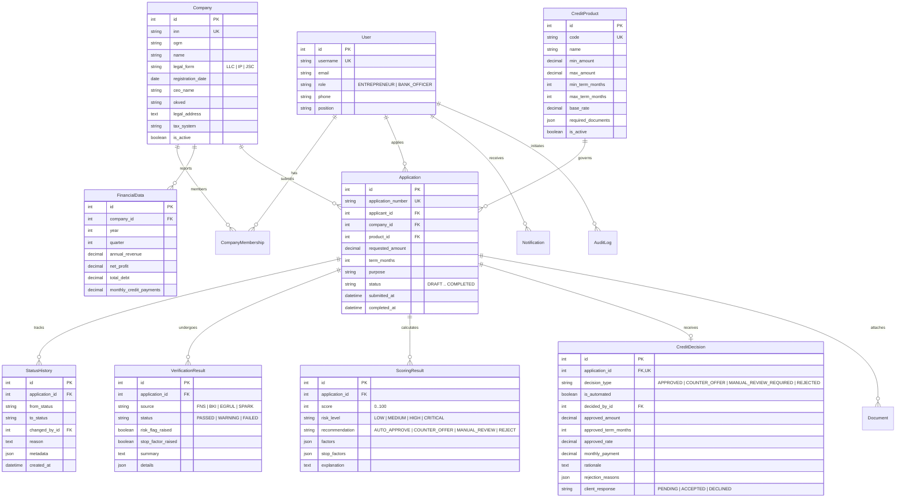

# Модель данных и ER-диаграмма

## 1. Реляционная структура базы данных (ERD)

---

## 2. Описание ключевых сущностей

| Сущность | Назначение | Ключевые поля |
| :--- | :--- | :--- |
| `User` | Учетные записи предпринимателей и сотрудников банка | `role`, `phone`, `position`, `email` |
| `Company` | Юридические лица и ИП заемщиков | `inn` (Уникальный индекс), `ogrn`, `legal_form`, `okved` |
| `FinancialData` | Финансовая отчетность предприятия (выручка, прибыль, долги) | `annual_revenue`, `net_profit`, `total_debt`, `monthly_credit_payments` |
| `CreditProduct` | Банковские кредитные программы с лимитами и базовой ставкой | `min_amount`, `max_amount`, `min_term_months`, `max_term_months`, `base_rate` |
| `Application` | Кредитная заявка (объект кредитного конвейера) | `application_number`, `status`, `requested_amount`, `term_months` |
| `StatusHistory` | Неизменяемый журнал движения заявки по статусам FSM | `from_status`, `to_status`, `changed_by`, `reason`, `created_at` |
| `VerificationResult` | Результаты внешних проверок государственных реестров | `source` (ФНС, БКИ, ЕГРЮЛ), `status`, `stop_factor_raised`, `details` |
| `ScoringResult` | Расчет кредитного риска (0-100) и классификация заемщика | `score`, `risk_level`, `factors`, `stop_factors`, `explanation` |
| `CreditDecision` | Итоговое кредитное решение (автоматическое или экспертное) | `decision_type`, `approved_amount`, `approved_rate`, `rationale`, `client_response` |
| `Document` | Загруженные файлы (бух. отчетность, выписки, паспорта) | `file`, `doc_type`, `is_verified`, `file_size_bytes` |
| `AuditLog` | Журнал аудита для комплаенс и информационной безопасности | `action`, `actor`, `resource_type`, `resource_id`, `timestamp` |
