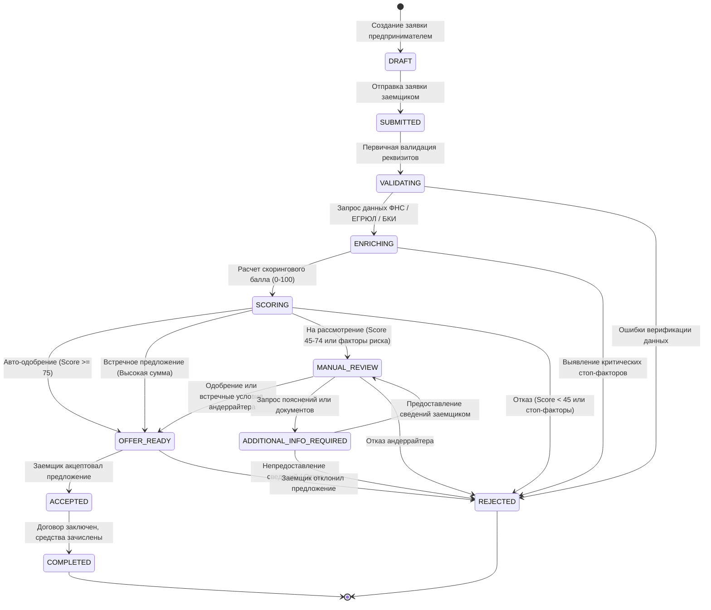

# Конечный автомат состояний заявки (FSM)

## 1. Схема жизненного цикла заявки

---

## 2. Матрица допустимых переходов состояний

| Исходное состояние | Допустимые целевые состояния | Инициатор перехода | Условие перехода |
| :--- | :--- | :--- | :--- |
| `DRAFT` | `SUBMITTED` | Заемщик | Заполнение обязательных полей заявки |
| `SUBMITTED` | `VALIDATING` | Конвейер | Успешная постановка в очередь обработки |
| `VALIDATING` | `ENRICHING`, `REJECTED` | Конвейер | Проверка соответствия лимитам продукта |
| `ENRICHING` | `SCORING`, `REJECTED` | Конвейер | Получение ответов от сервисов ФНС и БКИ |
| `SCORING` | `OFFER_READY`, `MANUAL_REVIEW`, `REJECTED` | Конвейер | Вычисление риска по скоринговой модели |
| `MANUAL_REVIEW` | `OFFER_READY`, `ADDITIONAL_INFO_REQUIRED`, `REJECTED` | Андеррайтер | Экспертное решение сотрудника банка |
| `ADDITIONAL_INFO_REQUIRED`| `MANUAL_REVIEW`, `REJECTED` | Заемщик / Андеррайтер | Предоставление клиентом запрошенных данных |
| `OFFER_READY` | `ACCEPTED`, `REJECTED` | Заемщик | Принятие или отказ от условий финансирования |
| `ACCEPTED` | `COMPLETED` | Конвейер | Подписание договора простой ЭП и выдача |

---

## 3. Гарантии целостности и аудит FSM

1. **Запрет недопустимых переходов:** Метод `ApplicationPipelineService.change_status` валидирует текущий статус по словарю `ALLOWED_TRANSITIONS`. Попытка прямого перехода, например, из `DRAFT` в `COMPLETED`, вызывает исключение `ValidationError`.
2. **Атомарность (ACID):** Все изменения статуса, создание записей истории и аудит-логов выполняются внутри транзакции `@transaction.atomic`.
3. **Неизменяемый журнал (`StatusHistory`):** Каждый переход автоматически записывает:
   - Исходный и новый статус (`from_status`, `to_status`);
   - Инициатора действия (`changed_by`);
   - Текстовое основание (`reason`);
   - Метаданные скоринга или параметров решения (`metadata`).
