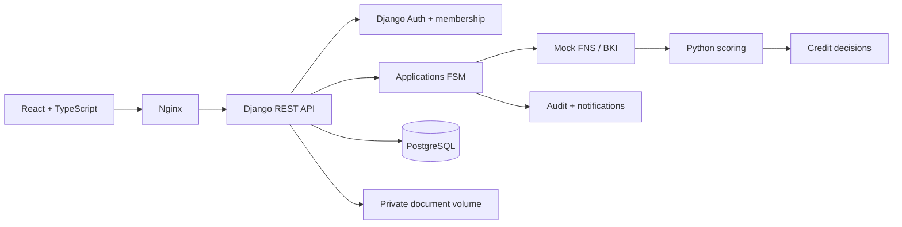
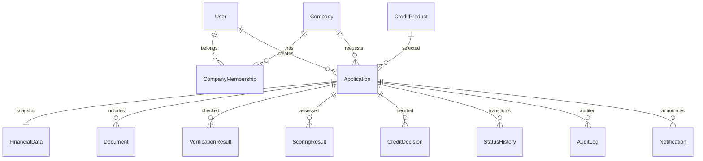
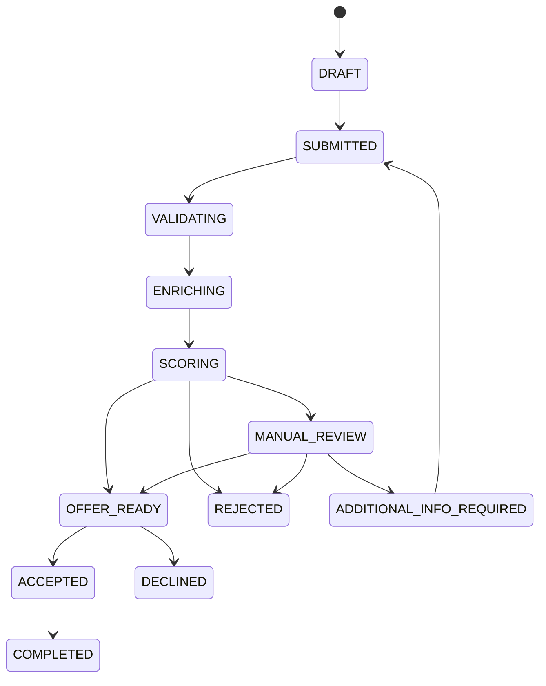

# Архитектура

Модульный Django монолит. React не рассчитывает решения и не хранит заявки локально. Nginx обслуживает SPA и проксирует API на тот же origin. Django session cookie HttpOnly, CSRF token обязателен для всех изменений, включая login. CORS не включён: междоменные API-запросы не требуются.

Модули: accounts — login/logout/profile и seed; companies — компания и членство; products — ограничения продукта; applications — снимок финансов и FSM; verification — сохранённые результаты двух mock-провайдеров; scoring — факторы и баллы; decisions — условия и решения по версии рассмотрения; documents — закрытое хранение; notifications — сообщения участникам компании; audit — журнал переходов и загрузок.

Каждое рассмотрение увеличивает revision. По версии допускается один scoring и одно решение; запрос дополнительных данных завершает текущую версию. Ручные решения разрешены только из MANUAL_REVIEW. Изменения блокируют строку заявки через SELECT FOR UPDATE и исполняются внутри atomic. Повтор отправки после рассмотрения возвращает текущее состояние. Повтор принятия/отклонения возвращает результат, противоположное действие запрещено. Создание идемпотентно по UUID creation_key в пределах пользователя; повтор с тем же ключом возвращает первую заявку. Ключ нужно менять для новой заявки. Принятый оффер не выдаёт деньги.

Файлы выдаются только после проверки доступа к заявке, по безопасному attachment-ответу. Проверяется PDF magic, расширение и размер до 5 МБ. Полноценного антивируса и парсера PDF нет; пользователь должен применять исключительно синтетические документы. Сырые внутренние оценки видны участнику собственной компании, все оценки синтетические. Сотрудники не могут создавать клиентские заявки и принимать офферы.
